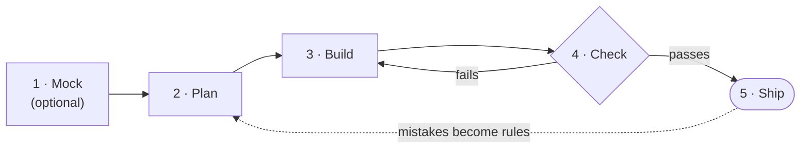
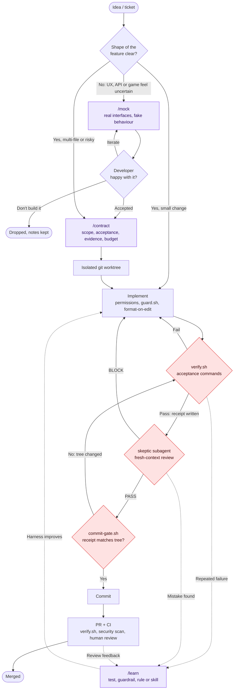

# harness

A Claude Code plugin with one skill, `harness-setup`, that installs an engineered harness into any repo:
agents work against explicit contracts, are verified by deterministic commands instead of their own
opinion, get reviewed by an independent subagent, and turn failures into durable rules.

## What is a harness?

If the model is the engine, the harness is everything around it: the instructions it reads, what it is
allowed to do, how its work gets checked, and what it remembers between sessions.

Think of a strong new hire. However good they are, they still need onboarding docs, the right access,
CI, and code review before you trust them to ship. A harness is that same setup, built for an AI agent.

Without one, Claude Code works from your chat message and its own judgement: it guesses the test
command, decides for itself when it's done, and reviews its own code. With one, every project gives it:

- **A map** - `CLAUDE.md` and rules: what the project is, the real commands, the conventions.
- **Guardrails** - what it may and may not do, enforced by config rather than by asking nicely.
- **A definition of done** - the project's own tests and linters, not "looks good to me".
- **A second opinion** - an independent reviewer that didn't write the code.
- **A memory** - mistakes turned into tests and rules, so they happen once.

All of it is plain files committed to the repo, so the whole team gets the same setup.

## Why it helps

Most bad agent runs aren't the model being "dumb". They come from vague goals, no limits, and no
objective check. The harness targets those causes directly:

| Without a harness | With the harness |
|---|---|
| Claude builds something, and only then you find out it's not what you wanted | `/mock` shows you a quick fake version first, so you can steer it cheaply |
| Small requests sprawl into unrelated refactors | `/contract` fixes the scope up front; going outside it means asking first |
| "Done" means Claude says it's done | Tests must pass on the exact files being committed, or the commit is blocked |
| The same model reviews its own work | A separate reviewer with a fresh context looks for what's wrong |
| Force-pushes, `reset --hard`, reading `.env` are one bad command away | Blocked by permissions and a guard hook before they run |
| Claude guesses commands and conventions differently each session | They're written down once, from what the project actually uses |
| The same mistake comes back every week | `/learn` turns it into a test, guardrail or rule |
| Every developer's agent setup is different | One shared, versioned setup per repo, installed by one command |

What developers get day to day: less babysitting, fewer permission prompts for routine commands,
smaller and more reviewable PRs, and the same workflow in every repo.

What it is **not**:

- **Not a replacement** for CI, security scanning, or human code review. It makes what reaches them better.
- **Not a framework you're locked into.** It's markdown, JSON and a few bash scripts in your repo;
  edit or delete anything.
- **Not heavyweight by default.** Small fixes skip straight to building, and the `light` profile
  drops the planning and review steps entirely.

## Install

```bash
/plugin marketplace add paezao/harness
/plugin install harness@paezao
```

Projects set up by the skill register this marketplace in their `.claude/settings.json`,
so teammates opening those repos get prompted to install it.

Then, in the project you want to set up:

```
/harness:harness-setup
```

(or just ask: "set up a harness for this repo"). Run it again later to audit or upgrade.

## How the process works

Every change goes through five steps. Claude does the work; you steer at the start and approve at the end.



| Step | What happens | Command |
|---|---|---|
| 1. Mock | Only when you're unsure what the feature should be. Claude builds a quick fake version you can click or play; you tweak it together until it's right. | `/mock` |
| 2. Plan | Claude writes down what it will change, what it won't touch, and how we'll know it's done. You OK it. | `/contract` |
| 3. Build | Claude implements it in a separate copy of the repo. Safety rules block dangerous commands; code is auto-formatted. | - |
| 4. Check | The project's tests and linters must pass, then a second, independent Claude reviews the change. Any problem sends it back to Build. | `/ship` |
| 5. Ship | Claude can only commit what was checked. Then the normal PR, CI and human review. | `/ship` |

When something goes wrong, `/learn` turns it into a test or rule so it doesn't happen again.
Small fixes can skip Mock and Plan and go straight to Build.

### Who does the work

Your Claude session is the coordinator: it talks to you and hands each job to a specialist agent,
each on the model that suits the job. The one that checks the work is never the one that did it.

| Step | Agent | Model | Job |
|---|---|---|---|
| Mock | `prototyper` | Sonnet | Builds each round of the mock while your session talks to you |
| Plan | `architect` | Opus | Writes the contract; no code |
| Build | `implementer` | Sonnet | Code changes, strictly inside the contract |
| Build | `designer` | Opus | Anything visual (only in projects with a UI) |
| Check | `checker` | Haiku | Runs tests and linters, reports only failures |
| Check | `skeptic` | Fable | Tries to break code changes, including a security review of each diff |
| Check | `design-skeptic` | Fable | Tries to break visual changes: themes, states, contrast |
| Any time | `explorer` | Haiku | "Where/how does this repo do X?" |
| Any time | `researcher` | Sonnet | Docs, APIs, library versions, with sources |

Reviewers only get the contract, never the builder's own summary, so they judge the code itself.

<details>
<summary>Detailed flow (every gate and loop)</summary>



Purple steps are skills, red diamonds are gates that block on failure, dashed lines are the learning loop.

1. **Mock (optional)** - when nobody is sure yet what the feature should look or feel like, `/mock` builds
   a quick version with real interfaces and fake data, tagged `HARNESS-MOCK` and hidden behind a flag or
   dev route. You iterate on it with Claude in minutes. Decisions go to `.claude/mocks/<slug>.md`.
2. **Contract** - for anything beyond a small change, `/contract` writes down scope, the commands that
   define "done", required evidence, and a budget. If a mock was accepted, it is the starting point and
   every mock tag becomes work to replace.
3. **Isolate** - multi-file work happens in a git worktree, so your main checkout stays usable.
4. **Implement** - permission rules, `guard.sh` and format-on-edit run automatically on every action.
5. **Verify** - `verify.sh` runs the acceptance commands and writes a receipt fingerprinted to the exact tree.
6. **Review** - the `skeptic` (or `design-skeptic` for visual work), on a different model from the
   builder and with read-only tools, reviews the diff against the
   contract and returns PASS or BLOCK.
7. **Commit gate** - Claude can only commit if a passing receipt matches the current files. Any edit
   after verifying means verifying again. `/ship` runs steps 5-7 for you.
8. **PR and CI** - the usual process (CI, security scanning, human review) still applies on top.
9. **Learn** - when something goes wrong, `/learn` turns it into a test, guardrail, rule or skill, so the
   same mistake doesn't happen twice.

</details>

`light` profile drops the contract, skeptic and commit gate; `strict` makes a skeptic PASS mandatory.

## What it puts in a project

| File | Purpose |
|---|---|
| `CLAUDE.md` | Short index: commands, layout, workflow, pointers to rules |
| `.claude/settings.json` | Narrow allow rules for real dev commands, deny rules for secrets, hooks |
| `.claude/harness/verify.sh` + `acceptance` | One "am I done?" command; writes a change receipt with a tree fingerprint |
| `.claude/hooks/commit-gate.sh` | Blocks agent commits unless a passing receipt matches the current tree |
| `.claude/hooks/guard.sh` | Blocks force-push, `reset --hard`, `rm -rf /`, reading `.env`, … |
| `.claude/hooks/format-on-edit.sh` | Runs the project's formatter on each edited file |
| `.claude/agents/` | The specialist agents above, each with its model, effort and tools |
| `.claude/skills/{mock,contract,ship,learn}` | `/mock` to explore, `/contract` before work, `/ship` to finish, `/learn` after mistakes |
| `.claude/mocks/` | Mock notes: decisions, settled interfaces, what is still faked |
| `.claude/rules/`, `.claude/state/decisions.md` | Topic rules and the why behind them |
| `.claude/harness/VERSION` | Which harness version the project is on, so audits know what to upgrade |
| `.github/workflows/harness-verify.yml` | Optional CI job running the same `verify.sh` on pull requests |

Profiles: `light`, `standard` (default), `strict`. See [SKILL.md](skills/harness-setup/SKILL.md).

## Customising for the team

- **Recommended skills:** edit [recommended-skills.md](skills/harness-setup/references/recommended-skills.md).
  This is the team's curated catalog; the setup skill offers entries whose signals match the repo.
- **Practices:** [practices.md](skills/harness-setup/references/practices.md) is the rationale and the
  audit checklist.
- **Stack detection:** [detection.md](skills/harness-setup/references/detection.md).
- **Templates:** everything copied into projects is under `skills/harness-setup/templates/`.
- **Your own fork:** to keep a team catalog, fork this repo, edit it, and change the marketplace repo in
  [templates/settings.json](skills/harness-setup/templates/settings.json) to your fork.

## Contributing

Issues and pull requests are welcome. Keep changes small and say what problem they solve; for a new
practice, include where it helped in a real project.

1. Edit the templates or references.
2. Run the template tests: `bash tests/run.sh` (CI runs them on Linux and Windows on every push).
3. Bump `version` in [.claude-plugin/plugin.json](.claude-plugin/plugin.json) and add a
   [CHANGELOG.md](CHANGELOG.md) entry with **Upgrade** steps, so audits can bring existing projects forward.

## Requirements

`bash` and `git` (on Windows, the Git Bash that Claude Code already uses). No `jq`, Node or Python needed.

## License

[MIT](LICENSE)
